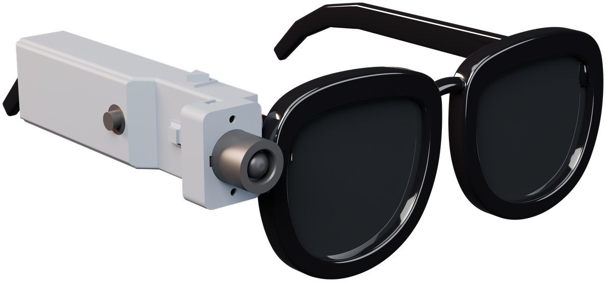
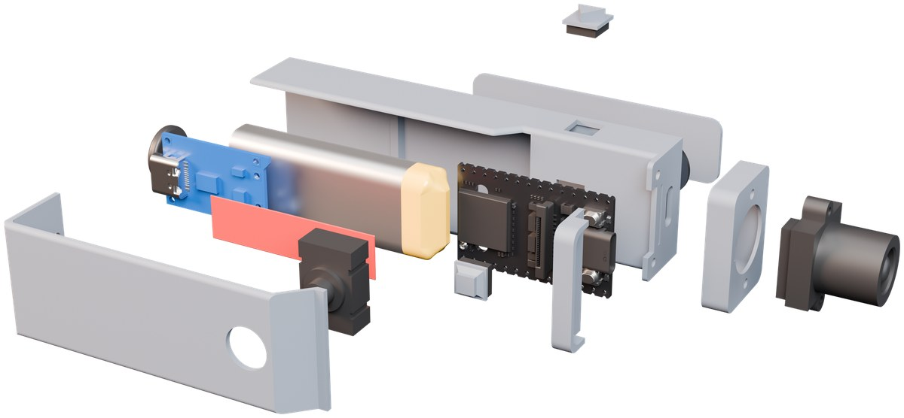
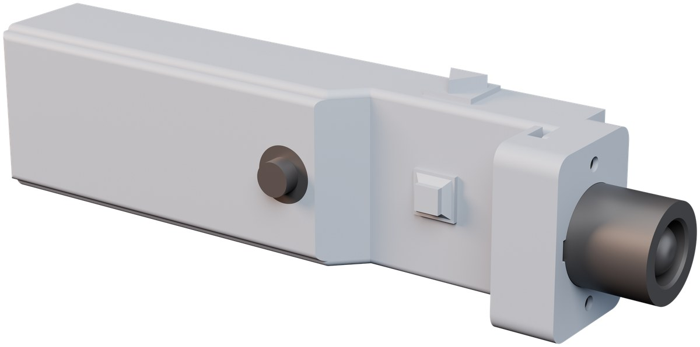
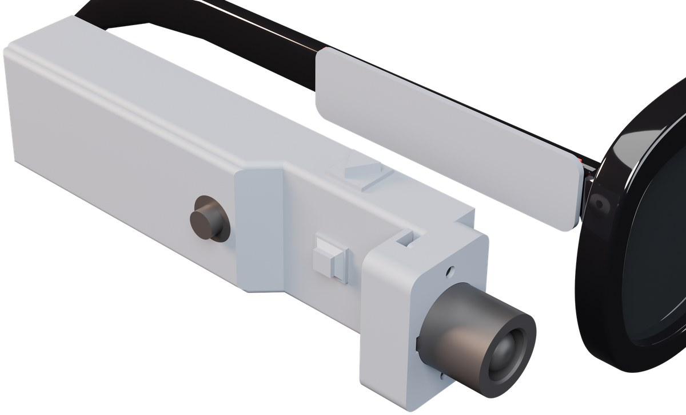

# AuralAI SDK

> On-device development platform for AI-powered visual assistants running on the **Sipeed MaixCAM**.  
> Designed to help visually impaired users recognize their surroundings via audio.

<p align="center"></p>

---

## Features

| Phase  | Feature                                                                                    | Status                                  |
| ------ | ------------------------------------------------------------------------------------------ | --------------------------------------- |
| **0**  | Web Dashboard, Camera Preview, Log Stream                                                  | ✅ Ready                                 |
| **0b** | Companion PC (MaixCAM + Flask, tested MVP)                                                 | ✅ `companion/` + `device/aural_maix.py` |
| **1**  | Object Detection (YOLO11n COCO), Audio Output, Explorer Mode                               | ✅ Ready                                 |
| **2**  | Scene Description (AI Vision), QRIS Verifier, Token Auth, Presets                          | ✅ Ready                                 |
| **3**  | Hybrid TTS, Log Rotation, Benchmark Suite, Data Collection, Audio Progress                 | ✅ Ready                                 |
| **4**  | Companion UI Redesign — `/` companion, `/admin`, `/guide`, `/setup`                        | ✅ Ready                                 |
| **5**  | Cloud pairing + public web hub (`web/`) — code pairing, remote config, docs, audio preview | ✅ Ready                                 |

---

## Architecture

**Path A — Dashboard on MaixCAM** (`device/main.py`):

```
MaixCAM Device
├── Thread 1 — AI Loop      → Camera → YOLO Inference → Detection Queue
└── Thread 2 — Web Server   → HTTP Dashboard + Snapshot Endpoint
                                        │
                               Browser (Phone / Laptop)
                               AuralAI Dev Dashboard
```

**Path B — Companion PC** (`device/aural_maix.py` + `companion/webserver.py`):

```
MaixCAM (Screen UI + Local YOLO) ──HTTP──► PC Flask (OpenAI Vision, MJPEG, Browser TTS)
                               └──► Browser observer (http://PC-IP:5000)
```

For setup details, see the *Companion PC* and *Network Testing* sections in [docs/setup.md](docs/setup.md).

---

## Cloud Pairing & Web Hub (`web/`)

First-time setup no longer depends on typing a `*.local` address. Once the device
is on WiFi it registers with the **AuralAI web hub** (Next.js on Vercel). The
helper opens the web hub and pairs in one of two ways:

- **Scan a QR with the camera** (fastest): the browser shows a signed, short-lived
  QR; point the AuralAI camera at it and the device claims itself automatically.
- **Type the spoken code**: the device speaks a short pairing code to enter.

Then they configure the AI provider + API key and audio preferences from the web —
settings are pushed back to the device over a cloud relay.

```
Device (MaixCAM)                Web hub (Vercel + Supabase)            Browser
  core/cloud.py  ── register ─►  /api/devices/register
  speaks code    ── code ─────►  /api/pair/code            ◄─ enter code ─ /pair
  long-poll      ◄─ config ───   /api/poll  ◄─ push config ─ /api/devices/:id/config
  apply + ACK    ── ack ──────►  /api/ack
  heartbeat      ── status ───►  /api/heartbeat            ─► /dashboard
```

Key properties:

- **Offline-safe.** If the cloud is unreachable, the device falls back to the
  local spoken-URL `/setup` flow and keeps retrying. WiFi onboarding is always local.
- **API keys are end-to-end encrypted** in the browser to the device's public key
  (`ecdh-p256-aesgcm`); the relay only ever stores ciphertext, deleted after ACK.
  See [`web/lib/e2e.ts`](web/lib/e2e.ts) ↔ [`device/utils/crypto_box.py`](device/utils/crypto_box.py).
- **Camera never leaves the LAN** — only high-level status (mode, battery, wifi) is sent.
- The hub also serves **public docs/tutorial** (`/docs`), an **audio & chime preview**
  (`/preview`), and a **QR code** for the pairing link.

### Run the web hub locally

```bash
cd web
npm install
cp .env.example .env.local         # set NEXT_PUBLIC_SITE_URL + Supabase keys
npm run dev                         # http://localhost:3000
```

Provision Supabase by running [`web/supabase/schema.sql`](web/supabase/schema.sql)
and enabling email magic-link auth. Deploy to Vercel with root directory `web`.

### Test the relay without hardware

```bash
pip install cryptography
python tools/mock_device.py --base-url http://localhost:3000
# prints a PAIRING CODE → open http://localhost:3000/pair, sign in, enter the code,
# set an API key → the mock device prints the DECRYPTED key (E2E verified) and ACKs.
```

On a real device, point [`device/config.py`](device/config.py) `cloud_base_url` at
your deployed hub (or your PC's LAN IP for local testing).

---

## Quick Start

```bash
# 1. Clone the repository
git clone https://github.com/<username>/AuralAI-SDK.git
cd AuralAI-SDK

# 2. Install PC dependencies
pip install -r requirements_pc.txt

# 3. Generate audio files
python tools/generate_audio.py

# 4. Deploy to MaixCAM
python tools/deploy.py

# 5. Access the dashboard
# Open your browser → http://maixcam.local:8080
```

### Preview Mockup (No Hardware Required)

Open `device/server/static/index.html` directly in your browser — the dashboard runs fully in simulation mode.

### Companion PC (MVP + OpenAI on PC)

```bash
pip install -r requirements_pc.txt
cp companion/.env.example companion/.env   # On Windows: copy companion\.env.example companion\.env
# Edit companion/.env and fill in your OPENAI_API_KEY
python companion/webserver.py
python companion/run_desktop.py            # Optional: Simulate with webcam
```

On your MaixCAM, set `AURAL_COMPANION_HOST` to your **PC's IPv4 address** (Wi‑Fi/Ethernet, not WSL IP), then run `python aural_maix.py` — see [docs/setup.md](docs/setup.md) for details.

---

## Perakitan & Instalasi Unit (MaixCAM / MaixCAM Lite)

Panduan untuk merakit satu alat AuralAI dari nol: solder, flash kartu SD, lalu cek.
Detail lengkap (fungsi tombol, alur setup tanpa layar, troubleshooting) ada di
[`docs/hardware_assembly.md`](docs/hardware_assembly.md).

<p align="center">
  <br>
  <sub>Exploded view: casing dan tutup, board MaixCAM, lensa kamera dan bracket depan, dua tombol, klip ke gagang kacamata.
  Baterai dan board charger di render adalah desain lanjutan; build sekarang masih pakai daya USB-C.</sub>
</p>

<table><tr>
  <td align="center"><br><sub>Modul utuh: lensa di depan, tombol di sisi</sub></td>
  <td align="center"><br><sub>Terpasang di gagang kacamata lewat klip</sub></td>
</tr></table>

### 1. Komponen per unit

| Komponen                        | Catatan                                                    |
| ------------------------------- | ---------------------------------------------------------- |
| Sipeed MaixCAM / MaixCAM Lite   | Kamera GC4653 bawaan; LCD tidak dipakai                    |
| Kartu microSD ≥ 8 GB            | Satu kartu per unit                                        |
| Speaker mini 8Ω, ≤ 2W           | Suara TTS + chime (amplifier sudah ada di board)           |
| Push-button momentary × 2       | **MODE** dan **AKSI**                                      |
| Kabel USB-C + adaptor 5V ≥ 1A   | Sumber daya. Baterai belum didukung                        |
| Kabel tipis + solder            |                                                            |

### 2. Solder

```
Tombol MODE  kaki 1 ──── pad A28   (sisi kanan, label "GPIOA 28 / UART2 TX")
Tombol MODE  kaki 2 ──── GND
Tombol AKSI  kaki 1 ──── pad A29   (sisi kanan, label "GPIOA 29 / UART2 RX")
Tombol AKSI  kaki 2 ──── GND       (boleh satu kabel GND bersama)
Speaker      merah  ──── SPK+
Speaker      hitam  ──── SPK-
```

- Tombol **tanpa resistor**: active-low dengan pull-up internal (lepas = HIGH, tekan = LOW).
- Pad ini sama dengan default `button_pin_mode` / `button_pin_action` di
  [`device/config.py`](device/config.py), jadi tidak perlu ubah setelan.
- Pastikan kabel FPC kamera terpasang rapat dan pengunci konektornya tertutup.
  Kalau longgar, sensor tidak terdeteksi (i2c timeout di log).

> ⚠️ **Jangan pakai pad ini untuk tombol:**
>
> | Pad         | Alasan                                                              |
> | ----------- | ------------------------------------------------------------------- |
> | **A14**     | LED onboard, diklaim kernel sebagai output → tombol tak terbaca     |
> | **P18–P23** | Jalur SDIO modul WiFi → tombol tak terbaca dan WiFi putus           |
> | **A26**     | WiFi EN → menekan tombol bisa mematikan WiFi                        |
> | **A15**     | Pernah terukur stuck-LOW di satu unit. Cek multimeter dulu          |
>
> Pad cadangan: **A22 / A23 / A24 / A25**. Kalau pindah, ubah `button_pin_mode` /
> `button_pin_action` di `/root/config.json` lalu restart app.
> Mod Bluetooth butuh resistor 0Ω di A18/A19/A28/A29. Kalau dipakai, tombol harus
> pindah ke A22–A25 dulu.

Pinout board: [wiki Sipeed MaixCAM](https://wiki.sipeed.com/hardware/en/maixcam/index.html).

### 3. Flash kartu SD (Windows)

Semua unit memakai satu **image siap-flash** yang sama. Isinya firmware, program
AuralAI, suara, WiFi, dan key terenkripsi. Image ini **tidak disimpan di repo**
karena berukuran ~1.6 GB dan berisi kredensial. Minta file `aural-lite-<tanggal>.img`
ke maintainer.

Identitas unit (nama `aural-XXXX`, `device_token`, kunci per-unit) dibuat oleh
masing-masing unit saat boot pertama: nama dari MAC wlan0, `/device_key` dari UID SoC.
Karena itu banyak unit dari image yang sama tidak bentrok.

Buka PowerShell **sebagai Administrator**:

```powershell
cd tools\provisioning
python flash_sd.py --list                               # cari nomor disk kartu SD
python flash_sd.py <path>\aural-lite-<tanggal>.img <N>  # tulis + verifikasi md5, ~3-5 menit
```

- `flash_sd.py` menolak disk sistem, disk non-USB/SD/MMC, dan disk di luar 4–256 GB.
  Tetap **cek ulang nomor disk** setiap kali, karena nomornya bisa berubah.
- Kalau Windows menawarkan "Format disk", pilih **Cancel**.
- Setelah tertulis "OK md5 …", kartu boleh dicabut.

### 4. Boot pertama & cek

1. Pasang kartu ke board, lalu colok USB-C ke daya yang stabil.
2. Sekitar 2 detik kemudian terdengar chime "AuralAI menyala". Boot pertama lebih lama
   (resize partisi dan pembuatan cache suara). Tunggu ±90 detik.
3. Buka dashboard dengan salah satu cara:
   - **WiFi**: unit otomatis tersambung ke jaringan yang tersimpan di image. Buka
     `http://aural-XXXX.local:8080`, atau tekan **MODE agak lama** untuk mendengar
     alamatnya.
   - **USB**: colok ke laptop. Unit muncul sebagai adaptor jaringan RNDIS dan menjadi
     DHCP server. IP unit = gateway adaptor itu (mis. `10.x.x.1`). SSH `root` / `root`.
4. Cek kesehatan unit (read-only, satu sesi SSH; butuh `pip install paramiko`):
   ```bash
   python tools/provisioning/verify_unit.py <host-atau-ip>
   ```
   Yang dicek: identitas, WiFi, proses app, suhu, RAM, config, error di log, dan `/status`.
5. Tes tombol: tekan **MODE**. Harus terdengar "tick" lalu nama mode.
   Tekan **AKSI** di mode Jelajah untuk mendeskripsikan apa yang ada di depan kamera.
6. Catat `device_key` dan nama `aural-XXXX` di label unit.

**Ganti WiFi tanpa reflash:** colok kartu ke PC, lalu edit
`wpa_supplicant.conf` (atau `wifi.ssid` / `wifi.pass`) di partisi FAT `boot`.
Simpan dengan line ending **LF**, bukan CRLF.

**Update program di unit yang sudah jalan:** `python tools/run.py --host <ip> --autostart`
(lihat `python tools/run.py --help`). Restart app hanya via SIGTERM / init script.
Jangan `kill -9`, karena watchdog hardware aktif.

---

## Project Structure

```
aural-ai-sdk/
├── companion/                # PC-side server + desktop runner (MVP)
│   ├── webserver.py          # Flask + dashboard + API for device
│   ├── minimal_server.py     # Connection test: MaixCAM ↔ PC (without OpenAI)
│   ├── run_desktop.py        # Simulate MaixCAM using a webcam
│   └── .env.example
├── device/                   # Code for MaixCAM (Python/MaixPy)
│   ├── main.py               # Main entry point
│   ├── aural_maix.py         # Alternative entry: UI + YOLO + companion hub
│   ├── wifi_connect.py       # WiFi helper (official MaixPy pattern, used by probe & aural_maix)
│   ├── network_probe.py      # HTTP connection test to PC (used with minimal_server)
│   ├── config.py             # Configuration constants
│   ├── core/
│   │   ├── orchestrator.py   # State machine, shared state
│   │   ├── ai_engine.py      # Camera + inference
│   │   ├── audio_manager.py  # Audio queue & playback
│   │   ├── onboarding.py     # Spoken-URL / pairing-code announcer
│   │   └── cloud.py          # Cloud pairing + config relay client (Phase 5)
│   ├── modes/
│   │   ├── explorer_mode.py  # Offline object detection
│   │   └── context_mode.py   # Online OpenAI mode
│   ├── server/
│   │   ├── web_server.py     # HTTP server
│   │   ├── routes.py         # API endpoints (documentation only)
│   │   ├── static/           # Static assets
│   │   │   ├── index.html    # Old operator dashboard (served at /admin/legacy)
│   │   │   ├── tokens.css    # Design tokens — single source of truth
│   │   │   └── app/          # Output of `vite build` (committed to repo)
│   │   └── src/              # Preact + Vite source for /, /admin, /guide, /setup
│   └── utils/
│       ├── logger.py
│       ├── identity.py       # Per-device id + spoken phrases (URL & pairing code)
│       ├── secure_keys.py    # API-key encryption at rest
│       ├── crypto_box.py     # E2E keypair for cloud-pushed secrets (Phase 5)
│       └── latency_tester.py
├── web/                      # AuralAI web hub — Next.js on Vercel (Phase 5)
│   ├── app/                  # Landing, /docs, /preview, /pair, /dashboard, /api/*
│   ├── components/           # Nav, QrSetup, DeviceConfigForm, …
│   ├── lib/                  # i18n, docs loader, supabase clients, e2e.ts
│   ├── content/docs/         # Markdown source for the public /docs pages
│   ├── supabase/schema.sql   # Tables + RLS for the relay
│   └── README.md
├── tools/                    # PC-side scripts
│   ├── generate_audio.py     # Pre-generate WAV files via gTTS
│   ├── deploy.py             # SCP deploy tool for MaixCAM
│   ├── mock_device.py        # Simulate a device against the web hub (no hardware)
│   └── model_converter.py    # Model helper (Phase 3)
├── models/                   # Model files (not committed)
├── audio/                    # Generated WAV files (not committed)
├── docs/
│   └── setup.md
├── requirements_pc.txt
└── README.md
```

---

## API Endpoints

### Pages (Phase 4 Redesign)

| Method | Endpoint        | Function                                                         | Auth                                          |
| ------ | --------------- | ---------------------------------------------------------------- | --------------------------------------------- |
| `GET`  | `/`             | Companion dashboard (redirects to `/setup` on first-time launch) | Optional                                      |
| `GET`  | `/admin`        | Admin dashboard (companion + dev sidebar)                        | `device_token` (or `admin_role_token` if set) |
| `GET`  | `/guide`        | Public user guide                                                | None                                          |
| `GET`  | `/setup`        | 4-step setup wizard                                              | Optional                                      |
| `GET`  | `/admin/legacy` | Old operator dashboard (fallback debug page)                     | Optional                                      |
| `GET`  | `/tokens.css`   | Design tokens (single source of truth)                           | None                                          |
| `GET`  | `/app/<...>`    | Hashed JS/CSS from Vite build                                    | None                                          |

### Data API

| Method | Endpoint                      | Function                                                                                  |
| ------ | ----------------------------- | ----------------------------------------------------------------------------------------- |
| `GET`  | `/snapshot`                   | Latest JPEG frame                                                                         |
| `GET`  | `/status`                     | JSON: mode, detections, latency, battery, wifi, audio_mode, last_caption, setup_completed |
| `GET`  | `/logs`                       | Latest log lines (last 50 lines)                                                          |
| `GET`  | `/history?date=today`         | Activity feed for companion dashboard                                                     |
| `GET`  | `/health`                     | Hardware health metrics                                                                   |
| `GET`  | `/audio/{file}`               | Serves WAV files                                                                          |
| `GET`  | `/audio/chimes/manifest.json` | List of available chimes                                                                  |
| `GET`  | `/assets/manifest.json`       | List of photo assets                                                                      |
| `GET`  | `/assets/{name}`              | Serves photo assets (falls back to mock SVG in UI)                                        |
| `POST` | `/command`                    | `{"cmd": "focus"\|"capture"\|"qris"\|"describe"\|"set_mode"}`                             |
| `POST` | `/config`                     | Updates config (audio_volume, audio_mode, setup_completed, etc)                           |

### Cloud Relay API (`web/`, Phase 5)

Hosted on the web hub (Vercel). Device endpoints authenticate with
`X-Device-Id` + `X-Device-Secret`; browser endpoints use the Supabase session.

| Method | Endpoint                  | Caller  | Function                                           |
| ------ | ------------------------- | ------- | -------------------------------------------------- |
| `POST` | `/api/devices/register`   | device  | Register id + E2E pubkey + fw                      |
| `POST` | `/api/pair/code`          | device  | Mint a short pairing code (10-min TTL, single-use) |
| `GET`  | `/api/poll`               | device  | Long-poll for the next pending config command      |
| `POST` | `/api/ack`                | device  | Confirm applied; relay deletes the command         |
| `POST` | `/api/heartbeat`          | device  | Push status (mode, wifi, battery)                  |
| `POST` | `/api/pair/scan`          | device  | Claim self from a scanned QR token (camera)        |
| `POST` | `/api/pair/qr`            | browser | Mint a signed QR claim token to display            |
| `POST` | `/api/pair/claim`         | browser | Claim a device with the spoken code                |
| `GET`  | `/api/devices`            | browser | List the user's devices                            |
| `GET`  | `/api/devices/:id`        | browser | Device detail incl. E2E pubkey                     |
| `POST` | `/api/devices/:id/config` | browser | Queue config + E2E-encrypted secrets               |

---

## UI Development

The UI source code is located in `device/server/src/` (built with Preact + Vite). The build output is committed to `device/server/static/app/` because the MaixCAM device does not run Node.js.

```bash
cd device/server/src
npm install                 # Run once
npm run build               # Generates ../static/app/{companion,admin,guide,setup}.html + assets/
npm run dev                 # Dev server on http://localhost:5173 (proxies /status, /snapshot, etc. to localhost:8080)
```

After running `npm run build`, commit the `static/app/` directory alongside your source changes.
For details on adding English language translations, refer to [`device/server/src/README.md`](device/server/src/README.md).

---

## Configuration

Edit `device/config.py` before deploying:

```python
MODEL_PATH        = "/root/models/yolo11n.mud"
CONF_THRESHOLD    = 0.5
CAMERA_FPS        = 30
WEB_PORT          = 8080
AI_FOCUS_DURATION = 5        # seconds
AUDIO_COOLDOWN_S  = 2.0      # cooldown between identical audio cues
OPENAI_MODEL      = "gpt-4o-mini"
```

---

## Hardware

- **Device:** Sipeed MaixCAM (regular variant) or MaixCAM Lite
- **Camera:** Built-in GC4653 sensor (320×224 default; MaixCAM Lite image runs 320×240 + `yolov8n.mud`)
- **Assembly & flashing:** see [Perakitan & Instalasi Unit](#perakitan--instalasi-unit-maixcam--maixcam-lite)
- **Network:** WiFi connection (HTTP server running on port 8080)
- **Storage:** MicroSD card for models, audio files, and system logs

---

## License

MIT License — free to use, modify, and distribute.

---

> Refer to [docs/setup.md](docs/setup.md) for the complete setup guide.
